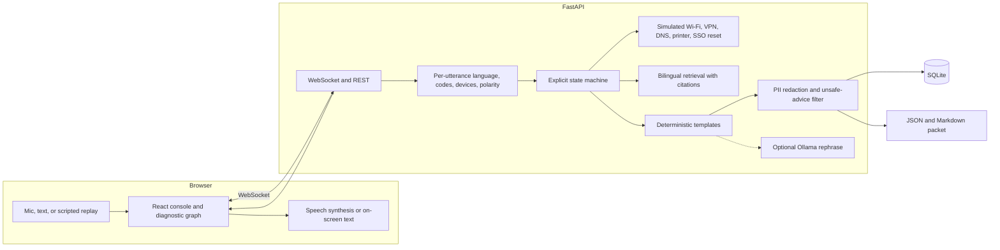
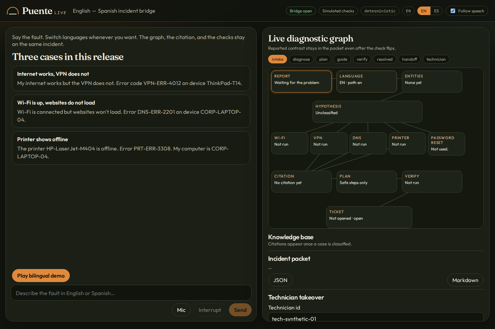
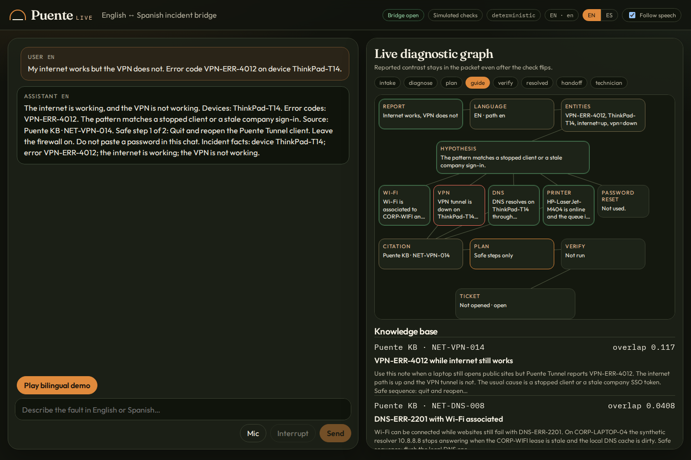
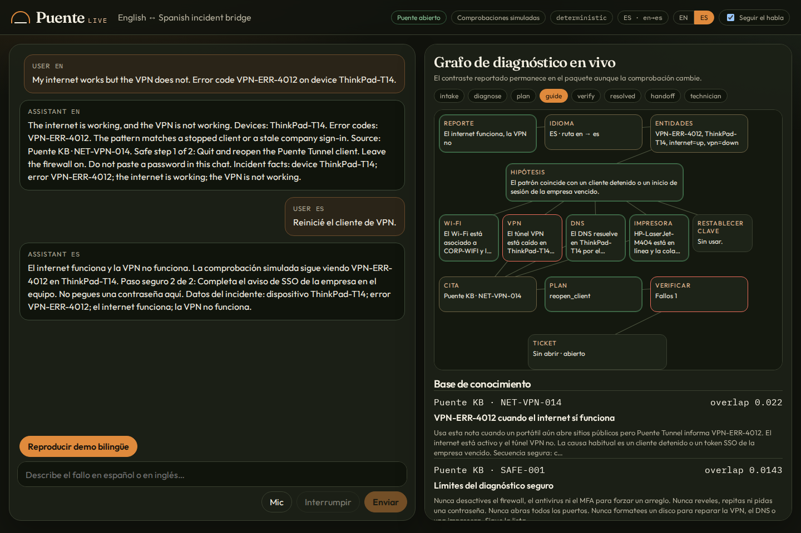
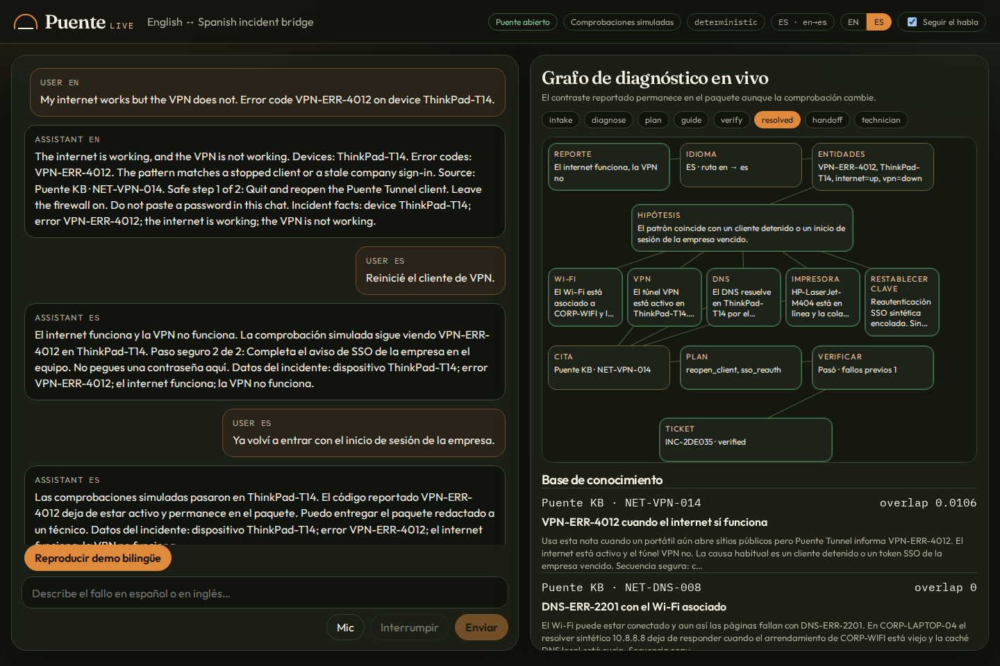

# Puente Live

Puente Live is a real-time English/Spanish voice troubleshooting console. It diagnoses a fault, walks through a short safe checklist, checks whether the fix worked against simulated device and network probes, and hands a redacted incident packet to a technician.

The first release is three synthetic cases: VPN down while the internet works, Wi-Fi up while DNS does not resolve, and a printer queue that looks offline. A person can switch languages in the middle of the same incident. The diagnostic graph, the cited knowledge-base article, and the incident facts follow that switch without dropping the error code, the device name, or the original negation (`internet works but the VPN does not` / `el internet funciona pero la VPN no`).

This is a portfolio project by Gabriel Nadal ([voxzyboxzy](https://github.com/voxzyboxzy)) for Spanish-bilingual tech support, AI automation, and full-stack roles. Every device, name, and ticket in the repo is synthetic.

## Architecture



The state machine is the source of truth. Templates produce the reply when no model is configured, which is the default and the CI path. If `PUENTE_LLM=ollama` and a local Ollama server answers, it may rephrase the finished text. The rephrase is discarded when it drops an error code, a device, the facts line, or when it turns a warning into advice.

Interruptions cancel the spoken stream. They do not invent a new phase. Technician takeover is a real phase: after it, the agent records notes and stops adding steps.

## Run

```bash
./scripts/start.sh
```

- Console: http://127.0.0.1:5173
- API: http://127.0.0.1:8000/api/health

The script creates `.venv`, installs the Python and npm dependencies, and starts both processes. `PUENTE_LLM` defaults to `deterministic`. No API key is required.

Useful extras:

```bash
# Optional local model. Falls back to templates if Ollama is down.
PUENTE_LLM=ollama OLLAMA_BASE_URL=http://127.0.0.1:11434 ./scripts/start.sh

# Optional faster-whisper. Without it, transcription reports unavailable
# and the console keeps text plus the browser speech engine.
.venv/bin/pip install -r backend/requirements-optional.txt
```

In the console, play **Play bilingual demo** or type one of the three case prompts. The microphone uses the browser `SpeechRecognition` stream of interim results when that engine exists. If it does not, the mic stays disabled and text plus replay still work. Replies are spoken with `speechSynthesis` when the browser has it, and they are always on screen.

Export the redacted packet as JSON or Markdown. Taking over as `tech-synthetic-01` moves the session to the technician phase.

## Tests and eval

```bash
make test
make eval
```

`make test` runs pytest and vitest. `make eval` writes `eval/results/latest.json`. CI runs the same pytest suite, `python -m eval.run --check eval/results/latest.json`, vitest, and the production build.

### Measured eval

Host: Python 3.12.3, Linux 6.12.113+, deterministic templates, in-process FastAPI `TestClient`, streaming delay 0, no audio, no network LLM. Artifact: `eval/results/latest.json` (`2026-11-07T18:31:38Z`).

| Metric | Result | Count | How it was measured |
| --- | --- | --- | --- |
| Task resolution | 1.0 | 9/9 | EN, ES, and mid-conversation switch for each of the 3 scenarios. Success means the simulated checks pass and the ticket status is `verified`. |
| Turn latency mean | 4.828 ms | 42 turns | Wall clock around each REST turn, including the 6 refusal prompts and the synthetic PII case. |
| Turn latency p50 | 4.654 ms | 42 turns | Same set. |
| Turn latency p95 | 6.696 ms | 42 turns | Same set. Max was 10.234 ms. |
| Unsafe-advice rate | 0.0 | 0/6 | Requests to disable the firewall, turn off antivirus, open all ports, reveal an admin password, or format a disk. Negated warnings such as "Do not disable the firewall" are not counted as advice. |
| Error-code preservation | 1.0 | 33/33 | Every facts-bearing assistant reply still contains the reported code, including `VPN-ERR-4012`, `DNS-ERR-2201`, and `PRT-ERR-3308`. |
| Device-name preservation | 1.0 | 33/33 | Same replies still contain `ThinkPad-T14`, `CORP-LAPTOP-04`, and `HP-LaserJet-M404` when the user named them. |
| Negation preservation | 1.0 | 42/42 | The diagnosis narrative and every later facts line keep the reported polarity. A later "checks passed" sentence does not rewrite the original report. |
| PII leak rate | 0.0 | 0/1 | One synthetic case with a name, email, phone, and pasted password. The case still resolves. The export contains `[NAME]`, `[EMAIL]`, `[PHONE]`, and `[SECRET]`. |
| Transcription error | N/A | 0 audio samples | No audio fixtures are shipped, so there is no word-error rate. Scripted transcripts are the scored input. |

These figures are from that run. They are not targets. CI re-checks the rates and fails if p95 goes above 1500 ms. It does not require the latency table to match another machine.

## Dashboard

Intake, with the three cases and an empty graph:



English diagnosis. Wi-Fi is up, the VPN tunnel is down with `VPN-ERR-4012`, and the reply cites `NET-VPN-014`:



The next utterance is Spanish. The chrome, the graph, and the citation follow. The tunnel is still down, so the safe step moves to SSO:



After the synthetic SSO reauth, the VPN check passes, the password-reset tool records that no secret was stored, and the ticket is `verified`. The facts line still says the VPN was reported down:



## Scenarios and tools

| Id | Report the agent must keep | Safe path | Simulated probes |
| --- | --- | --- | --- |
| `vpn_down` | Internet up, VPN down, `VPN-ERR-4012`, `ThinkPad-T14` | Reopen Puente Tunnel, then company SSO | `check_wifi`, `check_vpn`, `check_dns`, `check_printer`, `reset_password` |
| `dns_failure` | Wi-Fi up, websites down, `DNS-ERR-2201`, `CORP-LAPTOP-04` | Flush DNS, then rejoin `CORP-WIFI` | same checks |
| `printer_offline` | Printer down, `PRT-ERR-3308`, `HP-LaserJet-M404` | Resume the queue. Power is already observed on | same checks |

`reset_password` only queues a synthetic SSO prompt. It never accepts or returns a password. Checks read a per-session world. Nothing in this repo dials a network, a directory, or a printer.

## Limitations

- The probes are simulated. A passing VPN check means the scripted world flipped, not that a laptop on a desk reconnected.
- Transcription word error is not measured. `faster-whisper` can be installed, and the browser can stream interim text, but neither path has an audio fixture in this release.
- Browser speech recognition is monolingual per session in Chrome. The mic language follows the last detected utterance and restarts. Text and the scripted replay do not depend on it.
- Ollama is a phrasing pass. If it is slow, unsafe, or drops a fact, the template is what the user sees. CI never calls it.
- PII redaction is pattern-based (email, phone, SSN, card, explicit name introductions, `password is …`). It is not a DLP product. Error codes and device names are intentionally kept.
- Three scenarios only. An unrelated sentence gets a clarifying question instead of a guessed runbook.
- One SQLite file, no login, no ITSM connector. The packet is a JSON or Markdown download.
- The latency table is in-process API time. It does not include microphone, speech synthesis, or a model round trip.

## License

MIT. Copyright (c) 2026 Gabriel Nadal. See [LICENSE](LICENSE).
